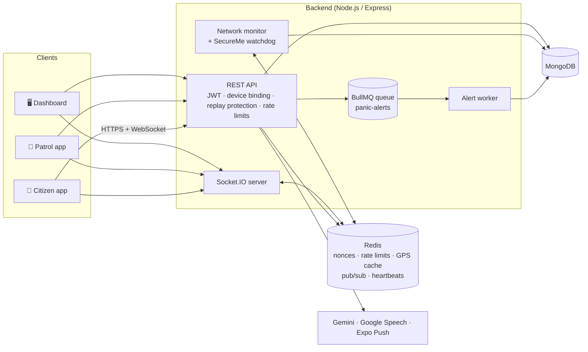
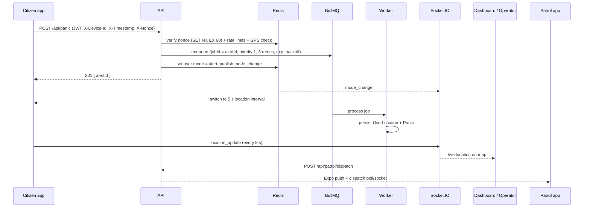

# 🚨 SecureOcte

### Real-Time Personal Safety & Emergency Response Platform

> Detect danger early. Process the alert reliably. Put the right responder on the way.

SecureOcte is an end-to-end safety platform made of four cooperating components: a **citizen mobile app**, a **patrol-officer app**, an **event-driven backend**, and a **live operations dashboard**. A distress signal travels from a phone to a control room to the nearest patrol vehicle in a single connected flow.

🏆 Recognized by the Government of Telangana – Women Safety Wing

> ⚠️ **Disclaimer:** SecureOcte assists with personal-safety monitoring. It is **not** a replacement for official emergency services. In an immediate emergency, call your local emergency number (112 in India).

---

## Table of Contents

1. [What makes it different](#-what-makes-it-different)
2. [Components](#-components)
3. [Features](#-features)
4. [Architecture](#-architecture)
5. [How the key flows work](#-how-the-key-flows-work)
6. [Security model](#-security-model)
7. [Tech stack](#-tech-stack)
8. [Project structure](#-project-structure)
9. [API overview](#-api-overview)
10. [Getting started](#-getting-started)
11. [Configuration reference](#-configuration-reference)
12. [Known limitations](#-known-limitations)
13. [Roadmap](#-roadmap)
14. [Author](#-author)

---

## 💡 What makes it different

Most safety apps stop at "a button that texts your contacts." SecureOcte focuses on two harder problems:

- **When the victim cannot press anything.** The SecureMe engine fuses motion sensors (IMU), GPS displacement and screen inactivity. If they indicate the user has gone unnaturally still, the app asks for a **biometric confirmation** before raising an alert.
- **When the signal simply disappears.** A server-side watchdog distinguishes "phone died or switched off" from "weak network" using battery level, retry counts, app state and heartbeat timing, and alerts operators only when the evidence supports it.

And it **closes the loop to the responder**: operators dispatch the nearest patrol unit from the dashboard, and the officer's app receives a push notification with the victim's location and navigation.

---

## 🧩 Components

| Component | Folder | Stack | Audience |
|---|---|---|---|
| Citizen app | `mobile-app/` | React Native (Expo 54) | Users |
| Patrol app | `patrol-app/` | React Native (Expo 54) | Police patrol vehicles / officers |
| Backend | `backend/` | Node.js, Express, Socket.IO, MongoDB, Redis, BullMQ | The system |
| Dashboard | `Dashboard/Dashboard.html` | Single-page HTML, Google Maps, Chart.js | Control-room operators (admin) |

---

## ✨ Features

### 🆘 Panic / SOS
- One-tap SOS with immediate server acknowledgement (`alertId`).
- Live location streamed every **5 s** after an alert (vs **15 s** in normal mode; the server switches the phone's mode in real time).
- Users can clear their own session when safe.

### 🚶 Walk Monitoring
- Persistent sensor engine with **adaptive sampling** (low-rate idle, high-rate burst when motion looks suspicious).
- Detects strong shakes, repeated medium shakes, abnormal rotation and unusual speed.
- Background location task raises a **Safety Check** notification with *"Yes, I'm Safe" / "No, Send Help"* actions.

### 🔐 SecureMe (inactivity detection)
- **Walk mode:** IMU still for 30 s **AND** (GPS moved < 12 m **OR** no screen touch for 30 s).
- **Cab mode:** IMU still for 40 s **AND** no screen touch for 40 s (GPS check disabled).
- 5 s grace window → biometric prompt (fingerprint / Face ID) → alert if not verified within 30 s. Any touch cancels verification.
- Point-in-polygon checks against admin-defined **high-risk zones**.

### 🚕 Cab / Auto Monitoring
- Destination-based trip tracking with live location.
- **Route-deviation detection:** heading difference above 60°, ignored at very low speeds (GPS noise), confirmed over several consecutive checks, with a cooldown.
- Notification actions: *I'm Safe / Suspicious / Need Help*; escalates if unanswered.
- **Police Support** button creates a fresh alert for every request.

### 📡 Network & Battery Watchdog
- Heartbeats every 15 s with battery, GPS, app state and network status, including retry/backoff and a "network unstable" mode.
- Two independent server-side detectors (Redis key-expiry watchdog and a heartbeat-scoring heuristic) with deduplication.

### 🎙️ Voice assistance
- Earphone (Bluetooth/wired) button press activates the assistant → records 5 s → server converts audio, transcribes it (Google Speech-to-Text) and classifies the intent with Gemini: `WALK_MONITORING`, `CAB_MONITORING` or `SOS`.
- Spoken trip commands ("drop me to …") are parsed into mode + destination.

### 🤖 Neha, the AI companion
- Gemini-powered chat assistant for travel-safety guidance and emotional support, with guardrails (never claims the user is "safe", no legal/medical advice, no confrontation advice). Rate-limited per user.

### 📝 Incident reporting
- Citizens report public disturbances, suspicious gatherings or risky behavior with crowd size, behavior indicators and a short note.
- The backend finds the **nearest active patrol vehicle** (Haversine) and pushes the report to it. Reports auto-expire after 7 days.

### 🔗 Live stream link
- Operators generate a shareable `/stream/<id>` link showing a user's live location; expires after 24 h.

### 🖥️ Operations dashboard
- Live alerts (panic, cab, walk, SecureMe, network, incidents), map view, statistics (today / week / month / lifetime), patrol tracking and **dispatch**, zone drawing, stream links, incident acknowledgement.

---

## 🏗️ Architecture



**Design principles**

- **Low latency:** the API acknowledges an SOS as soon as it is safely queued.
- **Reliability first:** deduplicated, prioritized, retried jobs; backpressure with a clear fallback message.
- **Security by design:** every sensitive route is authenticated, replay-protected, rate-limited and validated.
- **Horizontal scalability:** stateless instances, Redis pub/sub for socket fan-out, a distributed rate limiter, PM2 cluster config.

---

## 🔄 How the key flows work

### Panic pipeline



### Offline / "phone went dark" detection

1. Phones send a heartbeat (socket and REST). The server refreshes a Redis key with a short TTL.
2. When the key expires, the server re-checks after a short delay to rule out transient drops.
3. A scoring heuristic (battery level, retry count, network status, interval stability, app state) decides whether it looks like a network issue or a real disappearance.
4. Alerts are de-duplicated and pushed to dashboards as `NETWORK_ALERT`.

---

## 🔐 Security model

| Layer | Mechanism |
|---|---|
| Authentication | JWT (7-day expiry), bcrypt (cost 12), separate user / officer / admin roles |
| Device binding | `deviceId` embedded in the token must match the `X-Device-Id` header |
| Replay protection | `X-Timestamp` within ±30 s plus one-time `X-Nonce` stored in Redis; fails closed on Redis errors |
| Rate limiting | Redis-backed global limit (120/min/IP); panic limits at 2/10 s, 3/min, 10/10 min per user; separate tracking, stream, login, signup, chat and report limits |
| GPS plausibility | Speed limits by mobility mode and teleport detection (> 50 km in < 30 s) |
| Input validation | `zod` schemas, coordinate and field checks, 100 KB body cap, 10 s request timeout |
| Transport & headers | Helmet with strict CSP, host validation, CORS allow-list |
| WebSocket | Authenticated handshake, per-packet timestamp + nonce, per-event rate limits |
| Data minimization | TTL indexes: panic records 7 days, incident reports 7 days, live streams 24 h |
| Ownership checks | Users and officers can only modify their own trips; dispatch and statistics are admin-only |
| Hygiene | `npm run check:secrets` scans the source for hard-coded keys; structured logging with pino |

---

## 🛠️ Tech stack

- **Mobile:** React Native, Expo (location, sensors, notifications, local-authentication, task-manager, secure-store, av, speech), Socket.IO client, React Navigation, react-native-maps
- **Backend:** Node.js, Express, Socket.IO, Mongoose, ioredis, BullMQ, zod, helmet, express-rate-limit (+ rate-limit-redis), pino, multer, fluent-ffmpeg
- **Data:** MongoDB, Redis
- **AI / speech:** Google Gemini (`gemini-2.5-flash`), Google Cloud Speech-to-Text
- **Notifications:** Expo Push
- **Dashboard:** Vanilla JS, Google Maps JavaScript API, Chart.js
- **Ops:** PM2 cluster mode (`ecosystem.config.cjs`)

---

## 📂 Project structure

```text
SecureOcte-main/
├── backend/
│   ├── config/          # logger, Redis (single/cluster), DB indexes
│   ├── middlewares/     # auth, replay protection, rate limits, GPS guards, validation, helmet
│   ├── models/          # User, Officer, Panic, UserLocation, CabEscortTrip, PatrolTrip,
│   │                    # WalkSession, IncidentReport, LiveStream, NetworkAlert, HighRiskZone
│   ├── monitoring/      # /health endpoint
│   ├── public/          # stream.html (shareable live-location page)
│   ├── queues/          # BullMQ queue + worker
│   ├── routes/          # panic, auth, walk, cab-escort, patrol, incident, stream,
│   │                    # secureme, speech, voice, ai, stats, network-alerts
│   ├── scripts/         # check-no-hardcoded-secrets.mjs
│   ├── services/        # alertService, networkMonitor
│   ├── socket/          # socketManager (ESM), socketBridge (CJS shim)
│   ├── tests/
│   ├── gemini.js        # chatbot + voice intent classification
│   ├── ecosystem.config.cjs
│   └── server.js
├── mobile-app/
│   ├── App.js
│   └── screens/         # Home, Walk, Cab, SecureMe, Incident, AI chat, Voice, Profile,
│                        # api.js (secure fetch), socket.js, useWalkEngine.js, Batterymonitor.js
├── patrol-app/
│   ├── App.js
│   └── screens/         # Auth, PatrolVehicleScreen, api.js, socket.js
├── Dashboard/
│   └── Dashboard.html
└── README.md
```

---

## 🔌 API overview

All routes below require a Bearer token unless noted. Sensitive write routes additionally require `X-Device-Id`, `X-Timestamp` and `X-Nonce`.

| Area | Endpoints |
|---|---|
| **Auth** `/api/auth` | `POST /signup`, `POST /login`, `POST /register` (officer), `POST /admin/login`, `GET /me` |
| **Panic** `/api/panic` | `POST /` trigger · `PUT /location` live update · `DELETE /` clear · `GET /`, `GET /locations` (admin) |
| **Walk** `/api/walk` | `POST /start`, `POST /stop/:id`, `GET /active`, `GET /stopped`, `GET /history` |
| **Cab escort** `/api/cab-escort` | `POST /start`, `POST /update-location`, `POST /police-support`, `POST /complete/:tripId`, `GET /active`, `/history`, `/live/:tripId`, `/police-support`, `/user/:userId` |
| **Patrol** `/api/patrol` | `POST /start`, `POST /update-location`, `POST /dispatch` (admin), `POST /dispatch/acknowledge/:tripId`, `GET /active`, `/history`, `/live/:tripId`, `/pending-dispatch/:tripId`, `/officer/:officerId` |
| **Incidents** `/api/incident` | `POST /report`, `GET /my-reports`, `GET /assigned/:tripId`, `GET /pending` (admin), `POST /acknowledge/:id` |
| **SecureMe** `/api/secureme` | `POST /heartbeat`, `DELETE /heartbeat`, `POST /alert`, `POST /save-zone`, `GET /get-zone`, `DELETE /zone/:id` |
| **Streams** | `POST /api/stream/create`, `GET /api/stream/:streamId` (public, rate-limited), page at `/stream/:streamId` |
| **Voice / AI** | `POST /api/speech/transcribe`, `POST /api/speech/command`, `POST /api/voice/decision`, `POST /ai/chat` |
| **Ops** | `GET /api/stats/dashboard` (admin), `GET /api/network-alerts`, `GET /health` |

### WebSocket events

- **Client → server:** `location_update`, `HEARTBEAT`, `subscribe_location_updates`, `subscribe_patrol_dispatch`, `subscribe_incident_reports` (and their `unsubscribe_*` counterparts).
- **Server → client:** `mode` (`normal` | `alert` + interval), `location_update`, `NETWORK_ALERT`, `user_notification`, `subscription_ack`, `error`.

---

## 🚀 Getting started

### Prerequisites

- Node.js 18+ and npm
- MongoDB (local or Atlas)
- **Redis** (required: rate limiting and replay protection fail closed without it)
- Google Gemini API key, Google Speech-to-Text API key, Google Maps API key
- Expo tooling (`npx expo`) and a **physical device or development build** for background location, sensors and biometrics (Expo Go is not sufficient)

### 1. Clone

```bash
git clone https://github.com/nikhil-manne/Secureocte-ERS.git
cd Secureocte-ERS/SecureOcte-main
```

### 2. Backend

```bash
cd backend
npm install
```

Create `backend/.env` (see the [configuration reference](#-configuration-reference)). For **local development** you must set `ALLOWED_HOST`, otherwise every request is rejected by the host check:

```env
PORT=4000
MONGO_URI=mongodb://localhost:27017/secureocte
REDIS_URL=redis://localhost:6379
JWT_SECRET=change-me-to-a-long-random-string
ADMIN_USERNAME=admin
ADMIN_PASSWORD=change-me
GEMINI_API_KEY=your-key
GOOGLE_SPEECH_API_KEY=your-key
PUBLIC_BASE_URL=http://localhost:4000
ALLOWED_HOST=localhost:4000        # include the port; use <LAN-IP>:4000 when testing from a phone
EXTRA_CORS_ORIGINS=http://localhost:5500
```

Run it:

```bash
npm start          # production-style
npm run dev        # with nodemon
```

Sanity checks:

```bash
npm run check:syntax
npm run check:secrets
curl http://localhost:4000/health
```

### 3. Point the clients at your backend

The production URL is currently hard-coded in three places. Change them to your server:

| File | What to change |
|---|---|
| `mobile-app/screens/api.js` | `BASE_URL` |
| `patrol-app/screens/api.js` | `BASE_URL` |
| `Dashboard/Dashboard.html` | `const BASE = "…"` (around line 3486) |

Also replace the `YOUR_GOOGLE_MAPS_API_KEY` placeholders in `mobile-app/app.json` and `Dashboard/Dashboard.html`. The backend's socket CORS allow-list also includes the hard-coded production origin; add your own via `EXTRA_CORS_ORIGINS`.

### 4. Mobile and patrol apps

```bash
cd ../mobile-app      # or ../patrol-app
npm install
npx expo run:android  # or: npx expo run:ios / npx expo start --dev-client
```

### 5. Dashboard

Serve the file locally (the backend CORS list allows `http://localhost:5500` and `http://127.0.0.1:5500` by default):

```bash
cd ../Dashboard
npx serve -l 5500 .
```

Log in with the admin credentials from your `.env`.

### 6. Production (PM2 cluster)

```bash
cd backend
pm2 start ecosystem.config.cjs
```

Run behind a TLS-terminating proxy, set `REDIS_TLS=true` for managed Redis, and use `REDIS_CLUSTER` / `REDIS_CLUSTER_NODES` for cluster mode.

---

## ⚙️ Configuration reference

| Variable | Required | Purpose |
|---|---|---|
| `MONGO_URI` | ✅ | MongoDB connection string |
| `REDIS_URL` | ✅ | Redis connection (rate limits, nonces, GPS cache, pub/sub, queue) |
| `JWT_SECRET` | ✅ | Signs and verifies tokens |
| `ADMIN_USERNAME`, `ADMIN_PASSWORD` | ✅ | Dashboard admin login |
| `GEMINI_API_KEY` | ✅ | Chatbot and voice intent (server will not start without it) |
| `GOOGLE_SPEECH_API_KEY` | for voice | Speech-to-Text |
| `ALLOWED_HOST` | ✅ for non-default hosts | Host header suffix the API will accept (include port locally) |
| `PUBLIC_BASE_URL` | recommended | Used to build shareable stream links |
| `EXTRA_CORS_ORIGINS` | optional | Comma-separated extra allowed origins (REST and sockets) |
| `PORT` | optional | Defaults to `4000` |
| `REDIS_PASSWORD`, `REDIS_TLS` | optional | Managed Redis authentication / TLS |
| `REDIS_CLUSTER`, `REDIS_CLUSTER_NODES` | optional | Redis Cluster mode (`host:port,host:port`) |
| `HEALTH_TOKEN` | optional | Lets trusted monitors see detailed `/health` output |
| `GOOGLE_MAPS_KEY` | optional | Maps key used by the backend config |

> Never commit `.env` files or API keys. Run `npm run check:secrets` before pushing.

---

## ⚠️ Known limitations

Being explicit about these is part of treating a safety system seriously.

- **Detection thresholds are hand-tuned.** Inactivity, deviation and "phone went dark" logic has not yet been validated against measured false-positive / false-negative rates.
- **Voice SOS depends on external services** (speech-to-text and an LLM) and adds several seconds of latency. A local fallback (hardware-button multi-press or wake phrase) is planned.
- **Alert worker stages:** persistence is implemented; patrol dispatch and dashboard notification are performed by the REST/socket/push paths rather than inside the queue job.
- **Authorization hardening in progress:** some listing endpoints require a valid token but do not yet restrict results by role or ownership.
- **Duplicated middleware:** `secureme.cjs` carries its own token and replay checks, and there are two GPS-guard variants; consolidation is planned.
- **Token lifecycle:** 7-day JWTs without server-side revocation (a refresh-token model exists in the schema but is not yet wired up).
- **Test coverage is minimal.** Integration tests for the panic, replay-protection and heartbeat flows are a priority.
- **Environment coupling:** the production host is hard-coded in the clients and in the CORS/host allow-lists (see [Getting started](#3-point-the-clients-at-your-backend)).

---

## 🛣️ Roadmap

- [ ] Integration tests for panic, replay protection, dispatch and heartbeat flows
- [ ] Consolidate duplicated middleware; role/ownership checks on all listing endpoints
- [ ] Refresh-token rotation and token revocation
- [ ] Measure and publish false-alarm rates for the inactivity and deviation detectors
- [ ] Offline SOS fallback (hardware-button trigger, SMS)
- [ ] Dead-letter queue for failed alert jobs
- [ ] Intelligent nearest-response-unit selection for panic alerts (currently manual dispatch; incident reports already auto-route by distance)
- [ ] Offline synchronization, multi-region deployment
- [ ] Analytics and richer route intelligence
- [ ] Privacy controls: consent flows, access auditing, encryption at rest

---

## 👨‍💻 Author

**Manne Nikhil** — designer and developer of SecureOcte.


<div align="center">

### 🛡️ Technology for Safer Communities

**SecureOcte — Detect. Protect. Respond.**

</div>
